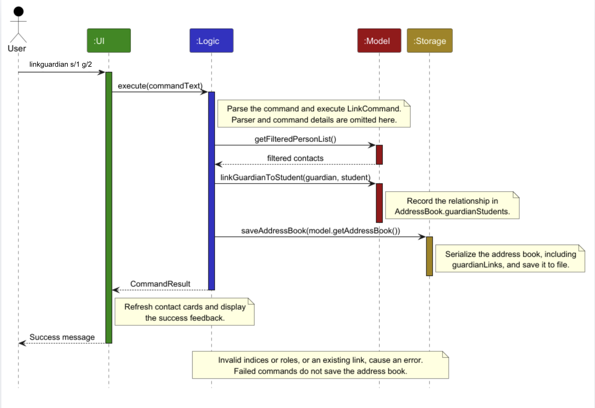
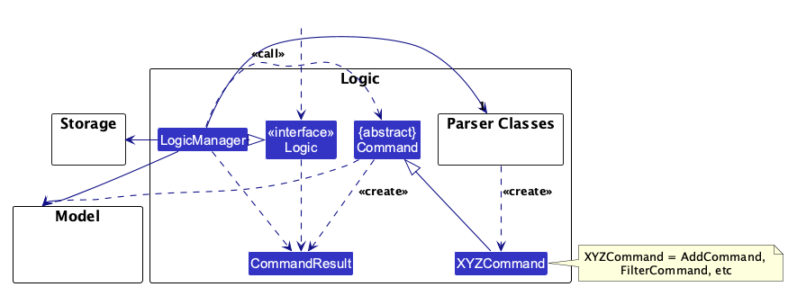
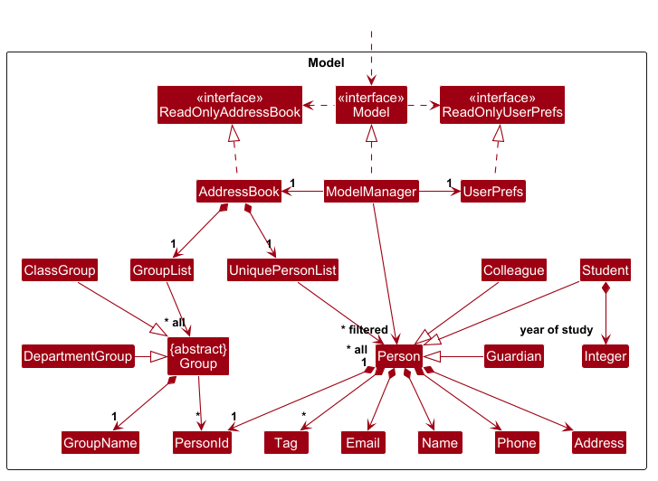
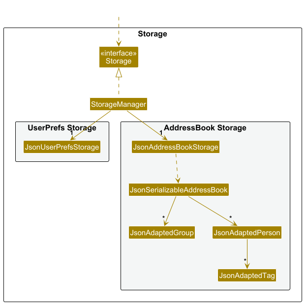
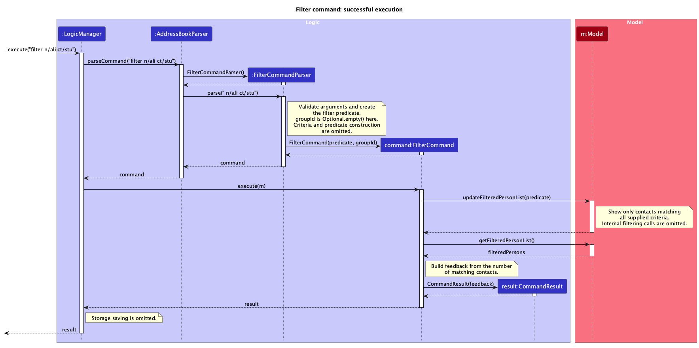

* Table of Contents
{:toc}

--------------------------------------------------------------------------------------------------------------------

## **Acknowledgments**

This project was adapted from [**AB3**](https://se-education.org/addressbook-level3/DeveloperGuide.html) and made use of the following external tools and libraries during development:

- Libraries used: [JavaFX](https://openjfx.io/), [Jackson](https://github.com/FasterXML/jackson), [JUnit5](https://github.com/junit-team/junit5)
- Generative AI tools: OpenAI Codex was used as a development assistant to support code generation, boilerplate implementation, debugging, documentation, and general software engineering tasks. All generated suggestions were reviewed, adapted, and validated by the project team.

--------------------------------------------------------------------------------------------------------------------

## **Setting up, getting started**

Refer to the guide [_Setting up and getting started_](SettingUp.md).

--------------------------------------------------------------------------------------------------------------------

## **Design**

:bulb: **Tip:** The `.puml` files used to create diagrams are in `docs/diagrams`. Refer to the [_PlantUML Tutorial_ at se-edu/guides](https://se-education.org/guides/tutorials/plantUml.html) to learn how to create and edit diagrams.

### Architecture

The ***Architecture Diagram*** given above explains the high-level design of the App.

The following provides a quick overview of the main components and their interactions.

**Main components of the architecture**

**`Main`** (consisting of classes [`Main`](https://github.com/se-edu/addressbook-level3/tree/master/src/main/java/seedu/address/Main.java) and [`MainApp`](https://github.com/se-edu/addressbook-level3/tree/master/src/main/java/seedu/address/MainApp.java)) is in charge of the app launch and shut down.
* At app launch, it initializes the other components in the correct sequence, and connects them up with each other.
* At shut down, it shuts down the other components and invokes cleanup methods where necessary.

The bulk of the app's work is done by the following four components:

* [**`UI`**](#ui-component): The UI of the App.
* [**`Logic`**](#logic-component): The command executor.
* [**`Model`**](#model-component): Holds the data of the App in memory.
* [**`Storage`**](#storage-component): Reads data from, and writes data to, the hard disk.

[**`Commons`**](#common-classes) represents a collection of classes used by multiple other components.

**How the architecture components interact with each other**

The *Sequence Diagram* below shows how the components interact when a user links a guardian to a student using `linkguardian s/1 g/2`.

Each of the four main components (also shown in the diagram above),

* defines its *API* in an `interface` with the same name as the Component.
* provides its functionality through a concrete `{Component Name}Manager` class that implements the corresponding API interface.

For example, the `Logic` component defines its API in `Logic.java` and implements it in `LogicManager.java`. Other components interact with a component through its interface rather than its concrete class, preventing them from coupling to that component's implementation, as illustrated in the following partial class diagram.

The sections below give more details of each component.

### UI component

The **API** of this component is specified in [`Ui.java`](https://github.com/se-edu/addressbook-level3/tree/master/src/main/java/seedu/address/ui/Ui.java)

The UI consists of a `MainWindow` and its parts, such as `CommandBox`, `ResultDisplay`, `PersonListPanel`, and `StatusBarFooter`. All of these, including `MainWindow`, inherit from the abstract `UiPart` class, which captures common behavior among classes that represent visible GUI parts.

The `UI` component uses the JavaFX UI framework. The layouts of these UI parts are defined in matching `.fxml` files in `src/main/resources/view`. For example, [`MainWindow.fxml`](https://github.com/se-edu/addressbook-level3/tree/master/src/main/resources/view/MainWindow.fxml) specifies the layout of [`MainWindow`](https://github.com/se-edu/addressbook-level3/tree/master/src/main/java/seedu/address/ui/MainWindow.java).

The `UI` component,

* executes user commands using the `Logic` component.
* listens for changes to `Model` data so that the UI can be updated with the modified data.
* keeps a reference to the `Logic` component, because the `UI` relies on the `Logic` to execute commands.
* depends on some classes in the `Model` component because it displays `Person` objects from the model.

### Logic component

**API** : [`Logic.java`](https://github.com/se-edu/addressbook-level3/tree/master/src/main/java/seedu/address/logic/Logic.java)

Here's a (partial) class diagram of the `Logic` component:

The sequence diagram below illustrates the interactions within the `Logic` component, taking `execute("delete 1")` API call as an example.

:information_source: **Note:** The lifeline for `DeleteCommandParser` should end at the destroy marker (X), but due to a limitation of PlantUML, it continues to the end of the diagram.

How the `Logic` component works:

1. When `Logic` is called upon to execute a command, the command is passed to an `AddressBookParser` object, which in turn creates a parser that matches the command (e.g., `DeleteCommandParser`) and uses it to parse the command.
1. This results in a `Command` object (more precisely, an object of one of its subclasses e.g., `DeleteCommand`) which is executed by the `LogicManager`.
1. The command can communicate with the `Model` when it is executed (e.g. to delete a person). 
   Note that although this is shown as a single step in the diagram above for simplicity, the code can require several interactions between the command object and the `Model` to complete the operation.
1. The result of the command execution is encapsulated as a `CommandResult` object which is returned from `Logic`.

Here are the other classes in `Logic` (omitted from the class diagram above) that are used for parsing a user command:

How the parsing works:
* When called upon to parse a user command, the `AddressBookParser` class creates an `XYZCommandParser` (`XYZ` is a placeholder for the specific command name, e.g., `AddCommandParser`). The parser uses the other classes shown above to parse the user command and create an `XYZCommand` object (e.g., `AddCommand`). The `AddressBookParser` returns that object as a `Command` object.
* All `XYZCommandParser` classes, such as `AddCommandParser` and `DeleteCommandParser`, implement the `Parser` interface so they can be treated similarly where appropriate, for example during testing.

### Model component
**API** : [`Model.java`](https://github.com/se-edu/addressbook-level3/tree/master/src/main/java/seedu/address/model/Model.java)

Some fields have been omitted to reduce clutter (optional contact details for Person).

The `Model` component,

* stores the address book data i.e., all `Person` objects (which are contained in a `UniquePersonList` object).
* stores the `Person` objects selected by the current filter, such as search results, in a separate _filtered_ list. It exposes this list as an unmodifiable `ObservableList<Person>` that the UI can observe and bind to, so the UI updates when the list changes.
* stores a `UserPrefs` object that represents the user’s preferences (currently, just the GUI settings). This is exposed to the outside as a `ReadOnlyUserPrefs` object.
* does not depend on any of the other three components (as the `Model` represents data entities of the domain, they should make sense on their own without depending on other components)

:information_source: **Note:** The alternative, arguably more object-oriented, design below keeps a unique list of tags in `AddressBook`, and each `Person` references tags from that list. This lets `AddressBook` maintain one `Tag` object per unique tag instead of each `Person` holding its own `Tag` objects. 

### Storage component

**API** : [`Storage.java`](https://github.com/se-edu/addressbook-level3/tree/master/src/main/java/seedu/address/storage/Storage.java)

The `Storage` component,
* can save both address book data and user preference data in JSON format, and read them back into corresponding objects.
* is implemented by `StorageManager`, which delegates the actual JSON file access to `JsonAddressBookStorage` and `JsonUserPrefsStorage` (one class per data file).
* depends on some classes in the `Model` component (because the `Storage` component's job is to save/retrieve objects that belong to the `Model`)

### Common classes

Classes used by multiple components are in the `seedu.address.commons` package.

--------------------------------------------------------------------------------------------------------------------

## **Implementation**

This section describes some noteworthy details on how certain features are implemented.

### Contact filtering

The command syntax is `filter [n/NAME] [ct/CONTACT_TYPE] [a/ADDRESS] [id/PERSON_ID]... [gid/GROUP_ID] [yos/YEAR_OF_STUDY] [t/TAG]...`.

The filtering flow is:

1. `FilterCommandParser` tokenizes the seven supported prefixes. It rejects an unexpected preamble, empty values, and duplicate `n/`, `ct/`, `a/`, `gid/`, or `yos/` prefixes. Repeated `id/` and `t/` prefixes are permitted.
2. Contact-type input is resolved to one `Role` using case-insensitive prefix matching. Full role names are accepted, and unknown or ambiguous prefixes cause a `ParseException`. This validation is specific to filtering; adding contacts still requires a full type.
3. Person IDs, Group IDs, and years of study are validated using `StringUtil.isNonZeroUnsignedInteger()` before conversion to integers. Values must be in the range `1` to `Integer.MAX_VALUE`. Leading zeros are normalized by numeric conversion, and Person IDs are collected into a set so numeric duplicates are ignored.
4. `PersonFilterCriteria` holds the optional name, role, address, and year-of-study criteria, together with defensive copies of the required tags and alternative Person IDs. The parser wraps these criteria in a `PersonMatchesFilterPredicate` and passes the optional Group ID separately to `FilterCommand`.
5. `PersonMatchesFilterPredicate` combines different criteria with `AND`. Person IDs use set membership (`OR` within the supplied IDs), while years of study use exact numeric equality and only match `Student` instances with a recorded year. Names and addresses use contiguous substring matching with `Locale.ROOT` for case conversion. Roles use enum equality, and tags use exact, case-sensitive set membership. All required tags must be present (`AND`).
6. When `gid/` is present, `FilterCommand` resolves the numeric ID against `Model#getGroupList()` using `GroupId#matches()`. It intersects the person predicate with the selected group's membership: `Person#getGroupId()` returns the assigned `GroupId`, which must equal the selected group's ID, and the contact must be a `Student` for a class or a `Colleague` for a department. An unknown Group ID matches no contacts. This numeric ID differs from the displayed group index used by `link gid/`.
7. `FilterCommand` installs the combined predicate through `Model#updateFilteredPersonList` and reports the result count. It replaces the previous predicate and filters the full contact list. Absent criteria impose no restrictions, but the parser requires at least one criterion. Bare `filter` raises a `ParseException` with the command format and leaves the current filter unchanged; `list` shows all contacts.

The following sequence diagram illustrates the successful execution of
`filter n/ali ct/stu`, without a group criterion:

Click the diagram to view it at full size.

Address matching checks for a non-null `Person#getAddress()` before reading its value. Contacts without an address do not match a supplied address criterion; they remain eligible when that criterion is omitted.

Name searches use `filter n/NAME`. The full supplied phrase is preserved and matched as a case-insensitive, contiguous substring, and can be combined with the other filter criteria.

#### Design choices

Substring matching lets users search names and addresses without knowing the full text. Exact tags and numeric IDs avoid matching similarly named tags or unrelated contacts. Different criteria use `AND` to narrow results; repeated IDs use `OR` to select several contacts, while repeated tags require all labels. IDs are independent of displayed positions, which can change after filtering.

#### Known limitations

* **Long whitespace sequences:** Unusually long runs of whitespace within filter
  values can slow parsing and temporarily make the interface unresponsive.
  Avoid pasting large whitespace sequences into filter values.
* **Save failures affecting Filter and Help:** The command-execution pipeline
  inherited from AB3 attempts to save the address book after successful command
  execution, including `filter` and `help`. If saving fails, a filter may already
  have changed the displayed results despite the reported error, while typed
  `help` may not open the Help window. Help remains accessible through the Help
  button or `F1`. Resolve the reported storage problem, checking write permissions
  for the data file and its folder where necessary.
* **Unicode whitespace:** Some Unicode spaces copied from formatted documents
  are not recognized as separators between filter criteria. A following prefix
  may be treated as part of the preceding value, producing unexpected results.
  Retype separators using ordinary spaces (`U+0020`).

### Person and Group IDs

PersonId and GroupId Using IDs for Person and Group allows users to be able to add persons and groups with the same names, which can be the case in their daily usage. 
These people or groups with the same name can still be distinguished through the unique IDs assigned to them. 

PersonId and GroupId's automatic assignment works by tracking a static counter variable to determine the next ID to assign. When a new person or group is added, the internal counter is incremented so that the next person or group has a different ID. 
When CaNvUS first starts up, the next ID is loaded and passed to the PersonId class to configure the next ID to assign through PersonId#setNextId.

Note:
* The IDS for Person and Group do not necessarily correspond to the indexes of the shown person and group lists.
* There is currently no error handling for the case where number of Persons or Groups exceeds maximum integer size. 

### \[Proposed\] Undo/redo feature

#### Proposed Implementation

The proposed undo/redo mechanism is facilitated by `VersionedAddressBook`. It extends `AddressBook` with an undo/redo history, stored internally as an `addressBookStateList` and `currentStatePointer`. Additionally, it implements the following operations:

* `VersionedAddressBook#commit()` — Saves the current address book state in its history.
* `VersionedAddressBook#undo()` — Restores the previous address book state from its history.
* `VersionedAddressBook#redo()` — Restores a previously undone address book state from its history.

These operations are exposed in the `Model` interface as `Model#commitAddressBook()`, `Model#undoAddressBook()` and `Model#redoAddressBook()` respectively.

Given below is an example usage scenario and how the undo/redo mechanism behaves at each step.

Step 1. The user launches the application for the first time. The `VersionedAddressBook` will be initialized with the initial address book state, and the `currentStatePointer` pointing to that single address book state.

Step 2. The user executes `delete 5` command to delete the 5th person in the address book. The `delete` command calls `Model#commitAddressBook()`, causing the modified state of the address book after the `delete 5` command executes to be saved in the `addressBookStateList`, and the `currentStatePointer` is shifted to the newly inserted address book state.

Step 3. The user executes `add n/David …​` to add a new person. The `add` command also calls `Model#commitAddressBook()`, causing another modified address book state to be saved into the `addressBookStateList`.

:information_source: **Note:** If a command fails its execution, it will not call `Model#commitAddressBook()`, so the address book state will not be saved into the `addressBookStateList`.

Step 4. The user now decides that adding the person was a mistake, and decides to undo that action by executing the `undo` command. The `undo` command will call `Model#undoAddressBook()`, which will shift the `currentStatePointer` once to the left, pointing it to the previous address book state, and restores the address book to that state.

:information_source: **Note:** If the `currentStatePointer` is at index 0, pointing to the initial AddressBook state, then there are no previous AddressBook states to restore. The `undo` command uses `Model#canUndoAddressBook()` to check if this is the case. If so, it will return an error to the user rather
than attempting to perform the undo.

The following sequence diagram shows how an undo operation goes through the `Logic` component:

:information_source: **Note:** The lifeline for `UndoCommand` should end at the destroy marker (X), but due to a limitation of PlantUML, it continues to the end of the diagram.

Similarly, how an undo operation goes through the `Model` component is shown below:

The `redo` command does the opposite — it calls `Model#redoAddressBook()`, which shifts the `currentStatePointer` once to the right, pointing to the previously undone state, and restores the address book to that state.

:information_source: **Note:** If the `currentStatePointer` is at index `addressBookStateList.size() - 1`, pointing to the latest address book state, then there are no undone AddressBook states to restore. The `redo` command uses `Model#canRedoAddressBook()` to check if this is the case. If so, it will return an error to the user rather than attempting to perform the redo.

Step 5. The user then decides to execute the command `list`. Commands that do not modify the address book, such as `list`, will usually not call `Model#commitAddressBook()`, `Model#undoAddressBook()` or `Model#redoAddressBook()`. Thus, the `addressBookStateList` remains unchanged.

Step 6. The user executes `clear`, which calls `Model#commitAddressBook()`. Since the `currentStatePointer` is not pointing at the end of the `addressBookStateList`, all address book states after the `currentStatePointer` will be purged. Reason: It no longer makes sense to redo the `add n/David …​` command. This is the behavior that most modern desktop applications follow.

The following activity diagram summarizes what happens when a user executes a new command:

#### Design considerations:

**Aspect: How undo & redo execute:**

* **Alternative 1 (current choice):** Saves the entire address book.
  * Pros: Easy to implement.
  * Cons: May have performance issues in terms of memory usage.

* **Alternative 2:** Individual command knows how to undo/redo by
  itself.
  * Pros: Will use less memory (e.g. for `delete`, just save the person being deleted).
  * Cons: We must ensure that the implementation of each individual command is correct.

--------------------------------------------------------------------------------------------------------------------

## **Documentation, logging, testing, dev-ops**

* [Documentation guide](Documentation.md)
* [Testing guide](Testing.md)
* [Logging guide](Logging.md)
* [DevOps guide](DevOps.md)

--------------------------------------------------------------------------------------------------------------------

## **Appendix: Requirements**

### Product scope

**Target user profile**:

* is a secondary school teacher
* teaches multiple classes
* prefers CLI applications
* occasionally needs to contact the guardians of students
* needs to contact colleagues

**Value proposition**: Manage contacts faster than with a typical mouse-driven GUI application.

### User stories

Priorities: High (must have) - `* * *`, Medium (nice to have) - `* *`, Low (unlikely to have) - `*`

| Priority | As a …​ | I want to …​ | So that I can…​                                                                                   |
|----------|---|---|---------------------------------------------------------------------------------------------------|
| * * *    | Teacher with many contacts | Add the name, phone number, email, and other relevant information for a contact | I can easily keep track of my contacts.                                                           |
| * * *    | Teacher with many contacts | Delete a contact | I can remove contacts that are no longer relevant                                                 |
| * * *    | Teacher with many students | Assign a student to a class | I can organize students based on the classes I teach                                              |
| * * *    | Teacher with many students | Add a student’s guardian’s name and relationship to student | I can easily find the contact information of a student’s guardian                                 |
| * * *    | Teacher who teaches multiple classes | Create a class | I can organize my students according to the classes I teach                                       |
| * * *    | Teacher who teaches new classes every year | Delete a class | Remove classes that are wrong or no longer needed                                                 |
| * * *    | Teacher with many students | Assign a guardian’s student to the guardian | I can easily find the contact information of a guardian’s ward.                                   |
| * * *    | Teacher who uses the app daily | Have my data saved automatically after every change | I can avoid losing my records once i close my app                                                 |
| * * *    | Teacher with multiple colleagues | Create a department | I can organize my colleagues according to the classes I teach                                     |
| * * *    | Teacher with multiple colleagues | Delete a department | I can remove classes that are wrong or no longer needed                                           |
| * *      | Teacher with many contacts | Edit a contact’s details | I can keep my records accurate when a contact’s information changes                               |
| * *      | Teacher with many contacts | Search for a contact by name | I can quickly find the contact I am looking for without scrolling through the entire address book |
| * *      | Teacher with many contacts | Filter contacts based on their details, e.g., name, class, relationship, etc. | I can easily search through my list of contacts to find the specific contacts I want.             |
| * *      | Teacher with many students | Mark a guardian as the primary contact | I know which guardian I should contact first when necessary                                       |
| * *      | Teacher with multiple colleagues | Assign a colleague to a department | Tell which department my colleague belongs to                                                     |
| *        | Teacher who wants to tailor my teaching to each student | Notes for each student | I can more easily keep track of who needs more attention/anything to follow up                    |
| *        | Teacher who teaches multiple classes | Import students' contact details based on nominal roll | I can easily add contacts of students when I start teaching a new class                           |
| *        | Teacher whose classes change regularly | Timed batch delete function at the end of every semester | I can easily remove contacts of students who are no longer in my classes                          |
| *        | Teacher with multiple colleagues | Import teachers’ contact details based on selected department | I can easily add contacts of colleagues when I join a new department                              |
| *        | Teacher who emails classes and colleagues | Copy and export emails or numbers of filtered contacts | I can easily set up mailing lists or group chats quickly with my students or colleagues.          |
| *        | Teacher | Export/reimport contact details to transfer data to another computer | I can easily transfer my data when I am issued a new laptop by my school's IT department          |
| *        | Teacher who is a first time user | See a help page | I can know how to use the app                                                                     |
| *        | Teacher who is an experienced user | Create new keybinds | I can more efficiently use this app in my workflow                                                |
| *        | Teacher | View a summary dashboard of total enrolled students and class counts | I can quickly verify overall roster completeness at a glance                                      |

### Use cases

(For all use cases below, the **System** is `CaNvUS` and the **Actor** is the `teacher`, unless specified otherwise)

**Use case: UC1 - Add a new contact**

**MSS**

1. Teacher requests to add a new contact with details.
2. CaNvUS adds the new contact.
3. CaNvUS displays a confirmation that contact was successfully added.
   Use case ends.

**Extensions**
* 1a. CaNvUS detects an error or a missing field in the entered data.
  * 1a1. CaNvUS displays an error and the expected input format. 
    Use case ends.

**Use Case: UC2 - Create a new group**

**MSS**
1. Teacher requests to create a new group
2. CaNvUS validates the group name and group type without rejecting duplicate groups
3. CaNvUS displays that new group was successfully created 
 
   Use case ends.

**Extensions**
* 1a. Group name is invalid
  * 1a1. CaNvUS shows an error message

    Use case ends.

* 1b. Group type is invalid
  * 1b1. CaNvUS shows an error message

    Use case ends.

**Use Case: UC3 - Edit an existing group**

**MSS**

1. Teacher requests to edit a group by providing its displayed group index and a new name.
2. CaNvUS validates that the group index and new group name are valid.
3. CaNvUS checks that no other group of the same type already has the new name.
4. CaNvUS replaces the selected group with the renamed group, preserving its group type.
5. CaNvUS displays that the group was successfully edited.

   Use case ends.

**Extensions**
* 2a. The group index does not refer to an existing group.
  * 2a1. CaNvUS shows an error message.

    Use case ends.

* 2b. The new group name is invalid or duplicates an existing group of the same type.
  * 2b1. CaNvUS shows an error message.

    Use case ends.

**Use case: UC4 - Delete an existing contact**

**MSS**

1. Teacher requests to delete a contact.
2. CaNvUS validates that the contact exists.
3. CaNvUS deletes the contact, removing any links to it.
4. CaNvUS displays that the contact was successfully deleted.
   
   Use case ends.

**Extensions**

* 2a. Contact does not exist.
  * 2a1. CaNvUS shows an error message.
    
    Use case ends.

**Use case: UC5 - Link guardian to student**

**MSS**

1. Teacher requests to link a guardian to a student.
2. CaNvUS validates that both the guardian and the student exist.
3. CaNvUS links the contacts of the guardian and the student together.
4. CaNvUS displays that the contacts of the guardian and the student were successfully linked.

   Use case ends.

**Extensions**
* 2a. Contact of the guardian or the student does not exist.
  * 2a1. CaNvUS shows an error message.
  
    Use case ends.

**Use case: UC6 - Link colleague to department**

1. Teacher requests to link a colleague to a department.
2. CaNvUS validates that both the department and the colleague exist.
3. CaNvUS links the contact of the colleague to the department.
4. CaNvUS displays that the contact of the colleague and the department were successfully linked.

   Use case ends.

**Extensions**

* 2a. Contact of the colleague or the department does not exist.
  * 2a1. CaNvUS shows an error message.
    Use case ends.

* 2b. Teacher attempts to link a colleague to a class.
  * 2b1. CaNvUS displays "Cannot link colleague to class."

    Use case ends.

**Use case: UC7 -  List all contacts**

**MSS**

1. Teacher requests to list all contacts.
2. CaNvUS retrieves all contacts.
3. CaNvUS displays the list of all contacts to the teacher.

   Use case ends.

**Extensions**

* 2a. There are no contacts stored.
  * 2a1. CaNvUS displays an empty contact list and the normal `Listed all persons.` success message.
    Use case ends.

**Use case: UC8 -  Filter contacts**

**MSS**

1. Teacher requests to filter contacts with a set of criteria.
2. CaNvUS validates the criteria provided.
3. CaNvUS retrieves contacts matching the criteria.
4. CaNvUS displays the list of filtered contacts to the teacher.

   Use case ends.

**Extensions**

* 2a. The criteria provided are not valid.
  * 2a1. CaNvUS shows an error message.
    
    Use case ends.

* 2b. No criteria was provided.
  * 2b1. CaNvUS displays an invalid-format error. The teacher can use `list` to display all contacts.

    Use case ends.

* 3a. No contacts match the criteria.
  * 3b1. CaNvUS informs the teacher that no contacts match the criteria.

    Use case ends.

### Non-Functional Requirements

1. **Capacity:** The application shall support at least 200 contacts.
2. **Performance:** The application shall complete each user command within one second when managing up to 200 contacts.
3. **Usability:** All commands shall be executable using only keyboard input.
4. **Learnability:** A first-time user who has read the Quick Start guide shall be able to add a student, guardian, or colleague without external assistance within five minutes.
5. **Reliability:** An invalid command shall not modify existing data.
6. **Product size:** The distributable JAR file shall not exceed 100 MB.
7. **Display compatibility:** The GUI shall be usable at resolutions of 1280 × 720 or higher and at screen scaling of up to 150%.
8. **Portability:** The application shall run on Windows, Linux, and macOS with Java `25` installed.
9. **Offline availability:** All core features shall operate without internet access.
10. **User capacity:** The application shall support a single user.

### Glossary

* **Class**: A group of students that the user would need to teach
* **Colleague**: Another teacher working in the same school as the user
* **Department**: A group of colleagues which work together in the school
* **Guardian**: A person legally in charge of taking care of the student, for example, their parent
* **Student**: A person who is enrolled in a class which the user is teaching

--------------------------------------------------------------------------------------------------------------------

## **Appendix: Instructions for manual testing**

Given below are instructions to test the app manually.

:information_source: **Note:** These instructions only provide a starting point for testers to work on;
testers are expected to do more *exploratory* testing.

### Launch and shutdown

1. Initial launch

   1. Download the JAR file and copy it into an empty folder.

   1. Double-click the JAR file. 
      Expected: The GUI opens with a set of sample contacts. The window size may not be optimal.

1. Saving window preferences

   1. Resize the window to an optimal size. Move the window to a different location. Close the window.

   1. Relaunch the app by double-clicking the JAR file. 
       Expected: The most recent window size and location are retained.

1. Exit and relaunch

   1. Test case: `exit` 
      Expected: The application closes without an error.

   1. Relaunch the JAR file. 
      Expected: The application starts normally and previously saved contacts are loaded.

### Managing persons

1. Adding a person

   1. Test case: `add n/Alice Tan p/91234567 e/alice@example.com a/1 Clementi Road ct/student yos/2 t/Year2` 
      Expected: Alice is added with the supplied details and appears in the person list.

   1. Test case: `add n/Betsy Crowe e/betsy@example.com ct/colleague t/Math` 
      Expected: Betsy is added as a colleague with the supplied tag.

   1. Test case: `add n/Guardian One ct/guardian` 
      Expected: A guardian is added. No year of study is shown.

   1. Other invalid commands to try: `add`, `add n/`, `add n/Alice p/ab12`,
      `add n/Alice e/not-an-email`, `add n/Alice ct/unknown`, and
      `add n/Alice ct/guardian yos/1`. 
      Expected: No contact is added and an error message is shown.

1. Editing a person

   1. Test case: `edit 1 p/99887766 e/alice.tan@example.com` 
      Expected: The first displayed contact is updated and the list shows the new phone number and email.

   1. Test case: `edit 1 t/` 
      Expected: All tags are removed from the first displayed contact.

   1. Other incorrect commands to try: `edit`, `edit 0 n/Changed`, `edit 1`, and
      `edit 99 n/Changed`. 
      Expected: No contact is modified and an error message is shown.

1. Filtering persons

   1. Test case: `filter n/ali` 
      Expected: Only contacts whose names contain `ali` are shown, ignoring case.

   1. Test case: `filter ct/student yos/2` 
      Expected: Only year-2 student contacts are shown.

   1. Test case: `filter id/1 id/2` 
      Expected: Contacts with either permanent Person ID 1 or 2 are shown.

   1. Test case: `filter t/Year2 t/Math` 
      Expected: Only contacts having both exact, case-sensitive tags are shown.

   1. Test case: `filter` 
      Expected: An error message is shown and the current list is unchanged. Run `list` to clear the filter.

### Managing groups and relationships

1. Creating and editing groups

   1. Test case: `addgroup CS2103T T01 gt/class` and `addgroup Mathematics gt/department` 
      Expected: A class and a department are added to the Groups panel.

   1. Test case: `editgroup 1 CS2103T T02` 
      Expected: The first group is renamed while retaining its group type.

   1. Other incorrect commands to try: `addgroup`, `addgroup Test gt/unknown`,
      and `editgroup 0 New Name`. 
      Expected: No group is added or modified and an error message is shown.

1. Linking a person to a group

   1. Prerequisites: Add a student, a colleague, a class, and a department. Note their displayed person and group indexes.

   1. Test case: `link pid/1 gid/1` for the student and class. 
      Expected: The student is assigned to the class and the relationship is shown.

   1. Test case: `link pid/2 gid/2` for the colleague and department. 
      Expected: The colleague is assigned to the department.

   1. Try linking a guardian to a group or a student to a department. 
      Expected: The command is rejected and existing assignments are unchanged.

1. Linking a guardian to a student

   1. Prerequisites: Add one student and one guardian and note their indexes in the current list.

   1. Test case: `linkguardian s/1 g/2` 
      Expected: The guardian–student relationship is shown on the relevant contact cards.

   1. Repeat the command, reverse the indexes, or use two students. 
      Expected: The invalid or duplicate relationship is rejected.

1. Deleting a group

   1. Prerequisites: Create a group and link at least one contact to it.

   1. Test case: `deletegroup 1` 
      Expected: The group is deleted, its contacts remain, and their group assignments are cleared.

   1. Test case: `deletegroup 0` or `deletegroup 99` 
      Expected: No group is deleted and an error message is shown.

### Clearing data

1. Clearing the address book

   1. Prerequisites: Ensure the address book contains contacts, groups, and at least one relationship.

   1. Test case: `clear` 
      Expected: All contacts, groups, and guardian–student relationships are removed.

   1. Relaunch the application. 
      Expected: The cleared state is retained; the lists remain empty.

### Deleting a person

1. Deleting a person while all persons are being shown

   1. Prerequisites: List all persons using the `list` command, with multiple persons in the list.

   1. Test case: `delete 1` 
      Expected: The first contact is deleted from the list. The status message shows the deleted contact's details.

   1. Test case: `delete 0` 
      Expected: No person is deleted. The status message shows error details.

   1. Other incorrect delete commands to try: `delete`, `delete x`, `...` (where x is larger than the list size) 
      Expected: Similar to previous.

1. Deleting a person from filtered results

   1. Prerequisites: Add at least two contacts, then run `filter n/Alice` so that the filtered list contains Alice.

   1. Test case: `delete 1` 
      Expected: The first contact in the filtered results is deleted. Any guardian–student relationships involving the deleted contact are also removed.

   1. Run `list`. 
      Expected: The deleted contact no longer appears in the full contact list.

1. Deleting a person with related contacts

   1. Prerequisites: Link a guardian to a student, and note both contacts' indexes.

   1. Test case: `delete <guardian index>` 
      Expected: The guardian is deleted and the guardian–student relationship is removed from the remaining student.

### Saving data

1. Dealing with missing/corrupted data files

   1. Close the application, then rename `data/addressbook.json` to
      `data/addressbook.json.bak` in the CaNvUS home folder. Relaunch the application. 
      Expected: The application starts with an empty address book and creates or uses a new valid data file after a successful command.

   1. Close the application and restore the backup file. Make a copy of the file,
      then replace the contents of `data/addressbook.json` with invalid JSON such as `{invalid`.
      Relaunch the application. 
      Expected: The application starts with an empty address book. The invalid file remains unchanged until a successful command saves a new address-book state.

   1. Restore the valid backup file and relaunch the application. 
      Expected: The contacts from the valid file are loaded correctly.

1. Verifying automatic saving

   1. Add or edit a contact, then close and relaunch the application. 
      Expected: The newly added or edited contact is still present with the updated details.

   1. Delete a contact or group, then close and relaunch the application. 
      Expected: The deleted item remains deleted after relaunch.

   1. Execute an invalid command, then close and relaunch the application. 
      Expected: The invalid command does not modify the saved data.
**Value proposition**: CaNvUS keeps a teacher's students, guardians and colleagues in one place, with students grouped by class, guardians linked to their wards and colleagues linked to their departments. Teachers can find the right person quickly and conveniently.
