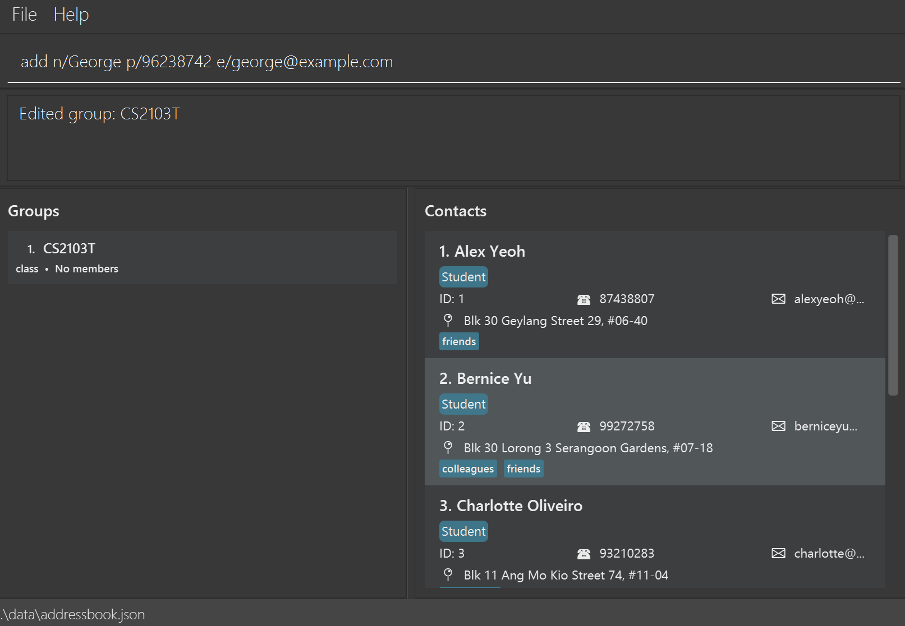

CaNvUS is a **desktop application for managing contacts, optimized for use through a Command Line Interface (CLI)** while retaining the benefits of a Graphical User Interface (GUI). If you type quickly, CaNvUS can help you manage contacts faster than traditional GUI applications.

* Table of Contents
{:toc}

--------------------------------------------------------------------------------------------------------------------

## Quick start

1. Ensure that Java `25` or later is installed on your computer. 
   **Mac users:** Ensure you have the precise JDK version prescribed [here](https://se-education.org/guides/tutorials/javaInstallationMac.html).

1. Download the latest `.jar` file from [here](https://github.com/AY2627S1-CS2103T-T11-3/tp/releases).

1. Copy the file to the folder you want to use as the CaNvUS home folder. This is the folder from which you will run the application.

1. Open a terminal, `cd` to the folder containing the JAR file, and run `java -jar addressbook.jar`. 
   A GUI similar to the one below should appear in a few seconds. Note how the app contains some sample data. 
   

1. Type a command in the command box and press Enter to execute it. For example, type **`help`** and press Enter to open the help window. 
   Some example commands you can try:

   * `list` : Lists all contacts.

   * `add n/Alice Tan p/91234567 e/alice@example.com a/1 Clementi Road ct/student t/Year1` : Adds a contact named `Alice Tan` to CaNvUS.

   * `delete 3` : Deletes the 3rd contact shown in the current list.

   * `clear` : Deletes all contacts, groups, and guardian–student relationships.

   * `exit` : Exits the app.

1. Refer to the [Features](#features) section below for details of each command.

--------------------------------------------------------------------------------------------------------------------

## Features

**:information_source: Notes about the command format:** 

* Words in `UPPER_CASE` are the parameters to be supplied by the user. 
  For example, in `add n/NAME`, replace `NAME` with a value such as `John Doe`.

* Items in square brackets are optional. 
  For example, `n/NAME [t/TAG]` can be used as `n/John Doe t/friend` or as `n/John Doe`.

* Items followed by `…`​ can appear zero or more times. 
  For example, `[t/TAG]…​` may be omitted, or written as `t/friend` or `t/friend t/family`.

* Command names are case-insensitive (for example, `HELP` and `help` are equivalent). Prefixes are case-sensitive.

* Prefixes can generally be in any order for commands that use prefixed fields. 
  For example, if the command specifies `n/NAME p/PHONE_NUMBER`, `p/PHONE_NUMBER n/NAME` is also acceptable.
  Positional arguments must still follow the command's format: `edit` requires the index first, `delete` takes an
  index, and `addgroup` requires the group name before `gt/`.

* Extraneous parameters for commands that take no parameters, such as `help`, `list`, `exit`, and `clear`, are ignored. 
  For example, `help 123` is interpreted as `help`.

* If you are using a PDF version of this document, be careful when copying and pasting commands that span multiple lines as space characters surrounding line-breaks may be omitted when copied over to the application.

### Viewing help: `help`

Opens the offline command-reference window. You can also open it using the **Help** button or by pressing `F1`.

Format: `help`

Opening Help again reuses the existing window and restores it if minimized. The feedback is `Opened help window.`

### Adding a person: `add`

Adds a person to the address book.

Format: `add n/NAME [p/PHONE] [e/EMAIL] [a/ADDRESS] [ct/CONTACT_TYPE] [yos/YEAR_OF_STUDY] [t/TAG]...​`

* Only `n/NAME` is required. Phone, email, address, contact type, year of study, and tags may be omitted. Except for tags, all fields may only be given at most once. The following field constraints apply when a value is supplied.
* `NAME` may contain letters, digits, and spaces, and must not be blank.
* `PHONE` must contain digits only and be at least 3 digits long.
* `EMAIL` must be a valid email address.
* `ADDRESS` must not be blank if supplied.
* `CONTACT_TYPE` must be `student`, `guardian`, or `colleague` (case-insensitive); omitting it defaults to `student`.
* `YEAR_OF_STUDY` is optional for students, including when the year is unknown. If supplied, it must be a positive integer from 1 to 2147483647. It is rejected for guardians and colleagues. 
* `TAG` may contain letters and digits only.

:bulb: **Tip:**
A person can have any number of tags, including zero.

:bulb: **Tip:**
If you don't have all the information for a contact right now, you can add them first then edit their information later.

Examples:
* `add n/Alice Tan` adds a student named "Alice Tan" with no other information recorded.
* `add n/John Doe p/98765432 e/johnd@example.com a/John street, block 123, #01-01 ct/student yos/2 t/groupLeader` adds a student named "John Doe" with phone number 98765432, email address johnd@example.com, address John Street, block  123, #01-01, year of study of 2 and a tag of "groupLeader".
* `add n/Betsy Crowe t/friend e/betsycrowe@example.com a/Jurong East p/1234567 ct/colleague t/neighbor` adds a colleague named "Betsy Crowe" with email betsycrowe@example.com, address Jurong East, phone number 1234567 and two tags "friend" and "neighbor".

### Listing all persons: `list`

Shows a list of all contacts in the address book. Groups are displayed separately in the Groups panel.

Format: `list`

The `list` command also clears any active contact filter and displays all contacts.

### Editing a person: `edit`

Edits an existing person in the address book.

Format: `edit INDEX [n/NAME] [p/PHONE] [e/EMAIL] [a/ADDRESS] [t/TAG]…​`

* Edits the person at the specified `INDEX`. The index refers to the index number shown in the displayed person list. The index **must be a positive integer** 1, 2, 3, …​
* At least one of the optional fields must be provided.
* Existing values will be updated to the input values.
* When editing tags, all of the person's existing tags are removed; adding tags is not cumulative.
* To remove all of a person's tags, enter `t/` without a tag after it.
* After editing, the displayed contact list is reset to show all contacts.
* The contact type and group membership cannot be changed with this command.

Examples:
*  `edit 1 p/91234567 e/johndoe@example.com` Edits the phone number and email address of the 1st person to be `91234567` and `johndoe@example.com` respectively.
*  `edit 2 n/Betsy Crower t/` Edits the name of the 2nd person to be `Betsy Crower` and clears all existing tags.

### Filtering persons: `filter`

Lists contacts that satisfy all supplied criteria.

Format: `filter [n/NAME] [ct/CONTACT_TYPE] [d/DEPARTMENT] [a/ADDRESS] [t/TAG]...​`

| Prefix | Criterion | Matching rule |
| ------ | --------- | ------------- |
| `n/` | Name | Case-insensitive, contiguous substring |
| `ct/` | Contact type | Case-insensitive full value or unambiguous prefix of `student`, `guardian`, or `colleague` |
| `d/` | Department | Case-insensitive, contiguous substring; only colleagues with a department can match |
| `a/` | Address | Case-insensitive, contiguous substring |
| `t/` | Tag | Case-sensitive, complete tag |

* Running `filter` without criteria shows all contacts.
* All supplied criteria must match (`AND`). For example, `ct/colleague d/science` requires both conditions.
* Each prefix can appear at most once, except `t/`. If multiple tags are supplied, every tag must be present.
* Empty values and repeated single-value prefixes are rejected. For example, `filter n/` and `filter d/Science d/Math` are invalid.
* Leading and trailing whitespace is ignored. The order and whitespace inside a name, address, or department phrase are significant.
* `ct/student` checks a contact's actual type. `t/Student` only checks for the exact tag `Student`.
* Contact-type abbreviations start at the beginning of the type: `ct/stu`, `ct/guar`, and `ct/col` are valid. Unknown or ambiguous abbreviations are rejected.
* Tags contain one or more letters or digits, without spaces or punctuation. For example, `Year2` is valid but `Year 2` and `Year-2` are invalid.
* Each filter replaces the previous search and checks all contacts; successive filters are not cumulative.
* If no contacts match, an empty list is displayed. A department criterion combined with `ct/student` or `ct/guardian` therefore produces no results.

Examples:

* `filter n/ali` matches names such as `Alice` and `Kalid`.
* `filter ct/STU` selects student contacts, regardless of their tags.
* `filter d/science` matches departments such as `Food Science` and `Computer Science`.
* `filter ct/col d/food sci` selects colleagues whose departments contain `food sci`.
* `filter n/ali a/clementi t/Student t/Year2` requires the name and address substrings and both exact tags.

### Creating a group: `addgroup`

Creates a class or department group.

Format: `addgroup GROUP_NAME gt/GROUP_TYPE`

* `GROUP_NAME` may contain letters, digits, and spaces, and must not be blank.
* `GROUP_TYPE` must be either `class` or `department` (case-insensitive). Group names do not allow hyphens.
* The group name must be unique for its group type.
* New groups initially have no members and are displayed in the Groups panel.

Examples:
* `addgroup CS2103T T01 gt/class`
* `addgroup Science gt/department`

### Linking a contact to a group: `link`

Assigns a student to a class or a colleague to a department. The group must already exist.

Format: `link pid/PERSON_INDEX gid/GROUP_INDEX`

* `PERSON_INDEX` is the positive position in the currently displayed contact list, including filtered results. It is not the permanent contact ID.
* `GROUP_INDEX` is the positive position in the Groups panel, counting from 1. It is not a permanent group ID.
* Both prefixes are required, may be in either order, and must appear once each.
* Students can be assigned only to class groups.
* Colleagues can be assigned only to department groups.
* Guardians cannot be assigned to groups.
* Linking to another group replaces the previous group assignment.

Examples:
* `link pid/1 gid/2` links the first displayed contact to the second group, provided their types are compatible.
* After filtering contacts, use their new displayed positions when linking.

### Linking a guardian to a student: `link-guardian`

Links a guardian to a student using their indices in the currently displayed contact list.

Format: `link-guardian s/STUDENT_INDEX g/GUARDIAN_INDEX`

* Both indices must refer to contacts in the currently displayed list, which may be filtered.
* The selected contacts must be a student and a guardian respectively.
* A contact cannot be linked to itself, and an existing relationship cannot be duplicated.
* Linked relationships are displayed on the relevant contact cards.

Example:
* `link-guardian s/1 g/2`

### Deleting a person: `delete`

Deletes the specified person from the address book.

Format: `delete INDEX`

* Deletes the person at the specified `INDEX`.
* The index refers to the index number shown in the displayed person list.
* The index **must be a positive integer** 1, 2, 3, …​

Examples:
* `list` followed by `delete 2` deletes the 2nd person in the address book.
* `filter n/Betsy` followed by `delete 1` deletes the 1st person in the filter results.
* Deleting a contact removes any guardian–student relationships involving that contact.

### Deleting a group: `deletegroup`

Deletes a group from the address book and unassigns all contacts belonging to that group.

Format: `deletegroup INDEX`

* `INDEX` refers to the 1-based index displayed beside each group in the Groups panel.
* `INDEX` must be a positive integer: 1, 2, 3, …​
* Students assigned to a deleted class and colleagues assigned to a deleted department are unassigned.
* A class and department may have the same name; deleting one affects only the matching group type.

Example:

* `deletegroup 1` deletes the first group shown in the Groups panel.

### Clearing all entries: `clear`

Clears all contacts, groups, and guardian–student relationships from the address book.

Format: `clear`

### Exiting the program: `exit`

Exits the program.

Format: `exit`

### Saving the data

CaNvUS automatically saves data after every successful command. You do not need to save manually.

### Editing the data file

CaNvUS data is saved automatically as the JSON file `data/addressbook.json` relative to the CaNvUS home folder. Advanced users are welcome to update that data file directly.

:exclamation: **Caution:**
If your changes make the data file invalid, CaNvUS starts with an empty address book at the next run. The invalid file remains on disk until you run a successful command (CaNvUS saves after every successful command). Still, we recommend backing up the file before editing it. 
Furthermore, certain edits can cause CaNvUS to behave unexpectedly (e.g., if a value entered is outside of the acceptable range). Therefore, edit the data file only if you are confident that you can update it correctly.

### Archiving data files `[coming in v2.0]`

_Details coming soon ..._

--------------------------------------------------------------------------------------------------------------------

## FAQ

**Q**: How do I transfer my data to another computer? 
**A**: Install the app on the other computer and overwrite the data file it creates with the data file from your previous CaNvUS home folder.

--------------------------------------------------------------------------------------------------------------------

## Known issues

1. **When using multiple screens**, if you move the application to a secondary screen, and later switch to using only the primary screen, the GUI will open off-screen. The remedy is to delete the `preferences.json` file created by the application before running the application again.

2. **Unrecognized filter parameters:** Unsupported prefixes following a text criterion may be treated as part of its
   value instead of producing an error. For example, `filter n/Alice p/9123` searches for the name text `Alice p/9123`;
   it does not filter by phone number. Use only the prefixes documented for `filter`.

--------------------------------------------------------------------------------------------------------------------

## Command summary

Action | Format, Examples
--------|------------------
**Add** | `add n/NAME [p/PHONE_NUMBER] [e/EMAIL] [a/ADDRESS] [ct/CONTACT_TYPE] [yos/YEAR_OF_STUDY] [t/TAG]…​`   e.g., `add n/John Doe p/98765432 e/johnd@example.com a/John street, block 123, #01-01 ct/student yos/2 t/groupLeader`
**Clear** | `clear`
**Delete group** | `deletegroup INDEX`  e.g., `deletegroup 1`
**Delete** | `delete INDEX`  e.g., `delete 3`
**Edit** | `edit INDEX [n/NAME] [p/PHONE_NUMBER] [e/EMAIL] [a/ADDRESS] [t/TAG]…​`  e.g., `edit 2 n/James Lee e/jameslee@example.com`
**Filter** | `filter [n/NAME] [ct/CONTACT_TYPE] [d/DEPARTMENT] [a/ADDRESS] [t/TAG]...`  e.g., `filter n/ali ct/student a/clementi t/Year2`
**List** | `list`
**Help** | `help`
**Create group** | `addgroup GROUP_NAME gt/GROUP_TYPE`  e.g., `addgroup CS2103T T01 gt/class`
**Link contact to group** | `link pid/PERSON_INDEX gid/GROUP_INDEX`  e.g., `link pid/1 gid/2`
**Link guardian to student** | `link-guardian s/STUDENT_INDEX g/GUARDIAN_INDEX`  e.g., `link-guardian s/1 g/2`
**Exit** | `exit`
